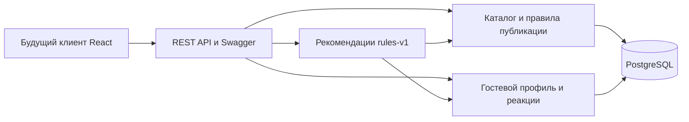

# Решение по архитектуре MVP

Контекст: команда из трёх человек, около 200 мест, локальный стенд с будущим публичным запуском.
Решение: модульный монолит FastAPI, PostgreSQL, async SQLAlchemy, Alembic, Docker Compose.
Цель — проверяемая вертикаль «каталог → предпочтения → подбор → реакция → обновлённый подбор».
Основание: модульный монолит соответствует размеру команды; отдельные сервисы, Redis и очередь
пока добавили бы эксплуатационные затраты без подтверждённой необходимости.

MVP включает US-01–US-05 и базовый редактор US-13 из предыдущего ТЗ; добавлен фильтр по радиусу
и discovery из новых идей. Профиль хранится сервером, браузер хранит токен: это явное уточнение
предыдущего предложения о полностью локальном профиле. Данные профиля не требуют email/пароля.
Dislike в MVP постоянный до отмены; сессии подбора и временное «не сейчас» требуют будущей модели.

Планы расширения:
- фото: таблица photo + источник/лицензия + адаптер хранилища;
- погода: отдельный адаптер прогноза с таймаутом и предупреждением, не блокирующим каталог;
- карта: React-компонент с координатами из того же API;
- отзывы, события, маршруты: отдельные модули со своими миграциями;
- подкатегории: связь category.parent_slug, при появлении реальных требований;
- рост геопоиска: PostGIS вместо фильтра Haversine в памяти;
- массовый импорт: валидатор CSV и транзакционный CLI, без публичной загрузки произвольных URL.

Рабочие предположения, не измеренные обещания: один публичный каталог, чтений заметно больше
записей, личные данные ограничены псевдонимным токеном и предпочтениями. Прогноз нагрузки и
production SLO не утверждены. Предварительные цели для будущего нагрузочного прогона:
p50 < 100 мс, p95 < 300 мс, p99 < 500 мс для каталога ~200 мест при 10 запросах/с на стенде;
доступность 99.5%, RPO 24 часа, RTO 4 часа после настройки и проверки резервного копирования.
Эти показатели пока НЕ доказаны. В текущем локальном стенде SLA отсутствует.

Официальные справочники:
- https://fastapi.tiangolo.com/tutorial/sql-databases/
- https://docs.sqlalchemy.org/en/20/orm/session_basics.html
- https://docs.docker.com/compose/how-tos/startup-order/
