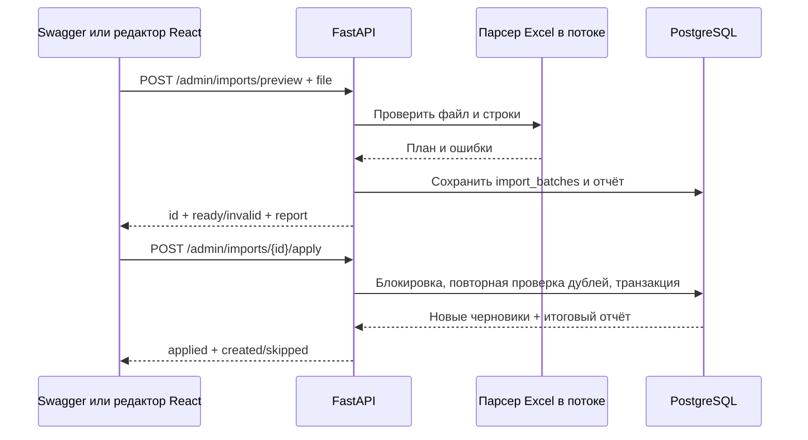
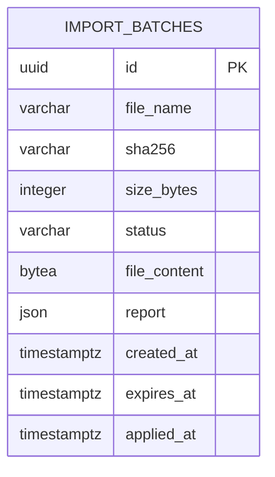
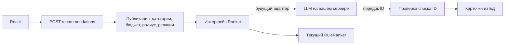

# Архитектура API импорта и подготовка LLM

Команда использует существующий FastAPI/PostgreSQL/React стек. Сейчас локальный стенд,
каталог порядка 200 мест, загрузки редкие и доступны редактору. Облачная инфраструктура
и конкретная LLM ещё не выбраны. Существующее приложение остаётся модульным монолитом.

## Загрузка и подтверждение





Внешнего ключа на places нет: один отчёт содержит множество созданных и пропущенных мест;
он является снимком результата операции, а не текущим состоянием каталога.
PK обслуживает просмотр и подтверждение, индекс expires_at — очистку, sha256 — поиск
совпадающих загрузок при диагностике. Хеш не UNIQUE: один файл разрешено проверить повторно.

Для небольших локальных Excel принято хранение проверенного файла в PostgreSQL BYTEA:
максимум 5 МБ на загрузку, срок подтверждения час. Это позволяет атомарно связывать
файл с отчётом и переживать пересоздание контейнера без общего файлового тома.
После успешной записи file_content удаляется, остаётся отчёт; ошибочные по строкам файлы
вообще не сохраняются. Просроченные готовые загрузки и отчёты старше 30 дней удаляются CLI:

```powershell
docker compose exec api python -m app.importing.cleanup
```

Очистка пока запускается вручную. Перед публичной эксплуатацией включить её в расписание
сервера. При частых/крупных загрузках перенести файлы в объектное хранилище с тем же id/hash.

Существующие места не обновляются автоматически. Блокировка PostgreSQL согласована с CLI,
а строка загрузки блокируется на время подтверждения. Повторное подтверждение возвращает
сохранённый результат; ошибка записи откатывает и места, и изменение статуса загрузки.
Превью не резервирует места: счётчики пересчитываются относительно актуальной БД при apply.

Защита: ключ редактора, лимит HTTP-тела до разбора multipart, лимит файла 5 МБ,
распакованных ZIP-данных 20 МБ и 2000 элементов, не более 10000 строк и 100 столбцов,
защищённый XML-парсер, запрет вычисления формул и выполнения макросов. Чтение книги вынесено
в поток, async SQLAlchemy-сессия остаётся в своей задаче. Целевой p95 preview для файла
каталога до 200 строк — 2 секунды на локальном стенде; это цель, не SLA.

## Граница будущей LLM



Ranker получает снимки уже отфильтрованных кандидатов и интересы/бюджет. Токен профиля,
ключ редактора и доступ к БД не передаются. Результат обязан содержать каждый разрешённый
UUID ровно один раз; неизвестные, повторяющиеся или пропущенные ID отклоняются.
При ошибке, таймауте 5 секунд либо неверном ответе используется RuleRanker.
Причины и баллы пока формируются текущими правилами, а не свободным текстом модели.
Указанный таймаут — начальная граница адаптера; после выбора LLM он требует замеров.

Самой интеграции с моделью пока нет. Для неё нужны адрес сервера, протокол API, имя модели,
формат структурированного ответа и способ авторизации. Добавлять GPU-контейнер или
привязываться к vLLM/Ollama до выбора этих параметров преждевременно.

Фронтенд использует прежний контракт recommendations. Алгоритм может менять порядок,
но проверка бюджета/координат/публикации остаётся обязанностью backend.
Текущий system prompt, если будет добавлен позже, должен считать описания мест данными,
а не инструкциями. Обработчик модели не получает инструменты записи в каталог.

## Проверяемые границы

HTTP-тесты: авторизация, настоящий multipart, ошибки строк и структуры, размер/ZIP,
preview без мест, подтверждение/повтор/конкурентное подтверждение, истечение срока,
откат и очистка исходных байтов. Отдельно проверяется CORS для ошибок загрузки.
Тесты Ranker: разрешённые кандидаты, порядок, подмена UUID, повторы/пропуски и fallback.
Frontend-показатели LCP/INP/CLS и production SLO пока не измеряются: самого интерфейса
и публичного стенда нет. Базовые будущие цели мобильного UI: LCP <= 2.5 с, INP <= 200 мс,
CLS <= 0.1; доступность API 99.5%, метрики требуют согласования и проверки на стенде.


Схема дополнительно проверялась schema_analyzer навыка database-designer. JSON-отчёт
сохранён намеренно как неизменяемый снимок операции: по отдельным полям отчёта запросы
не строятся. VARCHAR(255) для имени выбран по явному ограничению входного API.
Эвристические предложения нормализовать JSON и пересмотреть VARCHAR(255) здесь не
требуют изменения схемы. Фактические индексы и совместимость ORM проверены Alembic.
